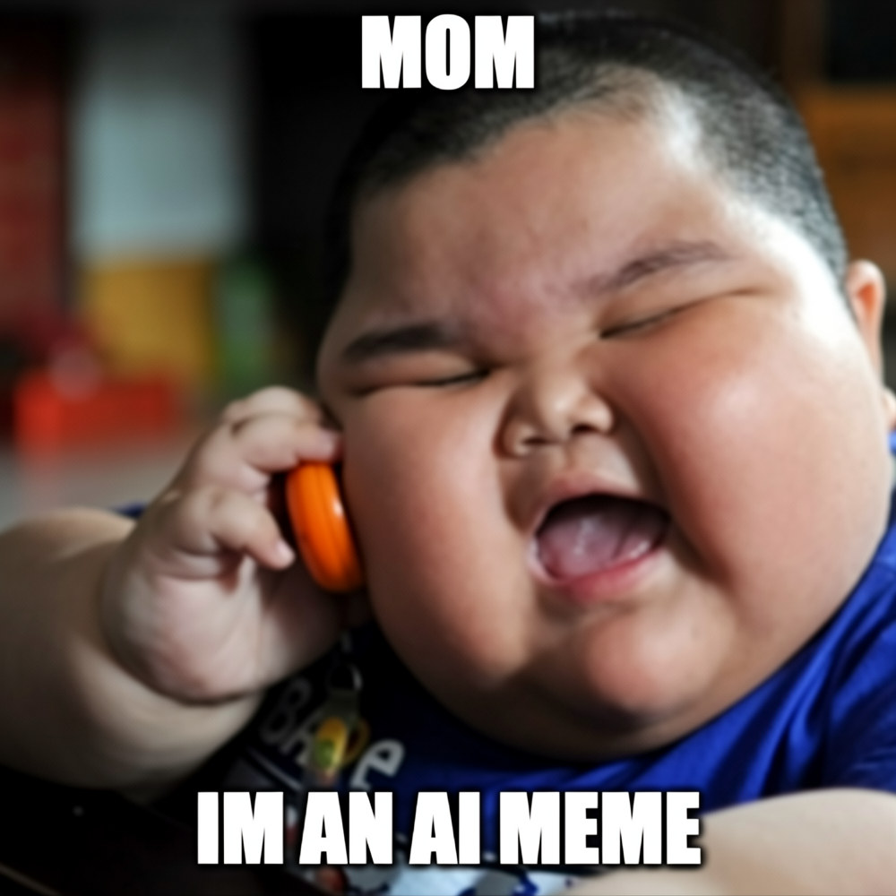

# memeGen

Image-to-text model that writes captions for meme templates. A frozen visual
encoder (CLIP ViT-B/32) feeds a generative decoder that predicts the top and
bottom lines.

[](https://colab.research.google.com/github/MohammeddArsh/memeGen/blob/main/demo.ipynb) [](report/report.pdf)



## Dataset

**memes900k** — 900,000 captions over 300 meme templates, from the
[DeepHumor](https://github.com/ilya16/deephumor) project. It ships as
`memes900k.zip`; extract it before running any code:

```bash
unzip memes900k.zip
```

## Setup

```bash
python -m venv .venv && source .venv/bin/activate
pip install -r requirements.txt
```

## Demo

The quickest start is the Colab notebook — click the badge above (or open
[`demo.ipynb`](demo.ipynb)). It clones this repo, downloads the trained
checkpoint from the [v1.0 release](https://github.com/MohammeddArsh/memeGen/releases/tag/v1.0),
and launches a Gradio app: upload or pick a template, choose sample or greedy
decoding, and get captioned memes.

To caption a single image locally with `caption.py`:

```bash
python caption.py --image memes900k/images/king-penguin.jpg \
    --checkpoint checkpoints/long_clip_transformer_emb768/best.pt \
    --overlay out.jpg
```

## Training

Train with `train.py` and evaluate with `eval.py`:

```bash
python train.py --out checkpoints/clip_transformer --encoder clip --decoder transformer
python eval.py --checkpoint checkpoints/clip_transformer/best.pt --split test
```
